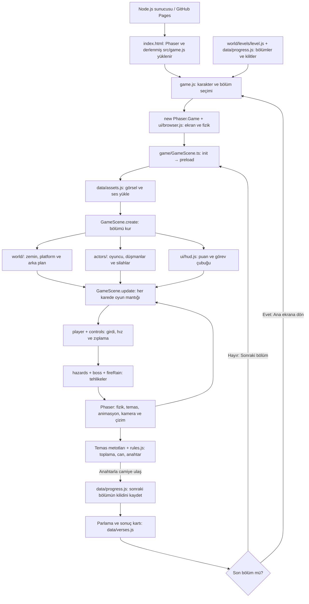

# Meyve Oyunu 2026

8–10 yaş için **TypeScript + Phaser** ile geliştirilen bir platform oyunu.
Amaç hem oyunu geliştirmek hem de kodunu adım adım anlayarak öğrenmek.
Bu bir öğrenme ve deneme projesidir; senaryo zamanla değişebilir. Yeni özelliklerde
çocukların kullanımı, okunabilir TypeScript ve bilgisayar/telefon/tablet desteği birlikte düşünülür.
Mobil desteği korumak için klavye ve dokunmatik giriş aynı hareket koduna bağlanır.

## Yerel Matter fizik atölyesi

Geliştirme sunucusunu `node scripts/serve.cjs` ile başlatıp
`http://localhost:8095/examples/matter-lab/index.html` adresini aç.
Kutu itme, kutuya çıkma, dönen/yığılan kutular, devrilerek köprü olan tahta ve
yuvarlanan taş burada denenir. `R` bütün gövdeleri ve eklemleri ilk konumlarına getirir;
`Esc` mola verir. Dokunmatik yön ve zıplama da desteklenir.
Üstteki alan seçimiyle on iki denemeden birine doğrudan başlayabilirsin. Tepeli parkurda
yerçekimiyle hızlanma, tahterevallide ağırlık/denge, esnek top ve domino alanında
sekme ve momentum aktarımı denenir.
İkinci alandaki yığılmış kutular serbestçe devrilebilir. Sekizinci alan 29 farklı
boy/ağırlıktaki kutuyla yığın, devrilme ve itiş denemesidir. Aynı boydaki hafif/ağır
kutuların yoğunlukları 6 kat farklıdır. Karakterin kuvvet sınırları `movement.ts`
içindeki `maxGroundForce` / `maxAirForce`, nesnelerin kütlesi ise boyut ve `density`
ile belirlenir. Büyük/ağır kutuların aynı hızla ilerlemesi zorlanmaz.
9–12. alanlarda sarkaç/ağır metal, iki askıyla taşınan platform, buz–kauçuk sürtünmesi
ve aynı yükseklikten bırakılan üç topun sekmesi karşılaştırılır. Son alandaki `↓`
düğmesi topları birlikte serbest bırakır; `R` deneyi tekrar hazırlar.
Bu dört düzenek `examples/matter-lab/experiments.ts` içinde aynı Factory oluşturucularıyla
tanımlanır. Askı bağlantıları `links` alanıyla, sürtünme `friction`, sekme `restitution`
ile seçilir; çizilmiş animasyon yerine Matter kuvvetleri ve bağlantıları kullanılır.

Bu sayfa normal bölüm listesine ve kayıtlı ilerlemeye bağlı değildir. `examples/`
yayın paketine kopyalanmadığı ve yayın önizleme sunucusu bu yolu açmadığı için
GitHub Pages/PWA kullanıcılarına sunulmaz. Mevcut ilk 45 bölüm Arcade kullanmaya devam eder.

Atölyenin verisi `examples/matter-lab/definition.ts`, başlangıcı `boot.ts` içindedir.
Ortak interface ve `prop` oluşturucuları `src/physics/matter/definitions.ts` içindedir.
Aynı klasördeki `MatterObjects.ts` gövde/görsel Factory'sini, `MatterRuntime.ts` kontrol
ve fizik döngüsünü, `movement.ts` hareket ayarlarını, `simulation.ts` 120 Hz sabit adımı yönetir.
Atölyenin eski modül yolları bu ortak kodu yeniden dışa açar; ikinci bir ayar kopyası yoktur.

## Ana oyundaki kapalı Matter pilotu

Yerelde `http://localhost:8095/?pilot=matter` adresini aç. Play'e bastıktan sonra
**Matter pilotunu dene** düğmesiyle gir. Kutu itme/üstüne çıkma, dönen kutu,
yuvarlanan taş ve devrilen tahta köprü; üç yıldız, anahtar ve cami akışıyla birlikte denenir.
Mola menüsündeki yenileme veya `R`, nesneleri ve toplananları bölüm başına döndürür.
Pilot kaydedilmiş bölüm ilerlemesini değiştirmez.

Pilot `src/world/levels/matterPilot.ts` içinde `physics: 'matter', draft: true` olarak
korunur. Normal bölüm listesinde yer kaplamaz. Yalnızca yerelde `?pilot=matter`
oturumunda 46'nın yerine konur; canlı alanda bu değişiklik uygulanmaz.
İlk 45 bölümün numaraları ve Arcade ayarları korunur.
`src/game/SceneFactory.ts` motoru seçer: Arcade için `GameScene`, Matter için
`MatterGameScene` açılır. Ortak `sceneRouting.ts` sözleşmesi mola/yenileme ve motor
değişimlerinde karakter/puan aktarımını sağlar. İki motor aynı bölümde karıştırılmaz.

Matter sahnesi ortak arka plan, platform, meyve/yıldız, anahtar, cami,
HUD, sonuç ekranı, bir can yenileyen abdest çeşmeleri ve yavaş, silahsız devriye düşmanlarını destekler. Silahlar, buz kayganlığı,
kolonlar ve özel Arcade senaryoları henüz Matter'a taşınmadı; bu alanlar eklenirse bölüm
doğrulaması açık bir hata verir. Mevcut bölümler bu sınırlamadan etkilenmez.

## Dünya 4: Ateş ve Çukur

`src/world/levels/world4.ts`, 46–60 arasındaki 15 bölümü tanımlar. 49/54/57 Matter
bulmacalarıdır; 50/53/58'de iki güvenli kıyı arasındaki tüm zemin lavdır ve yalnızca
platformlara basılabilir. Diğer parkurlarda ateş canlıları, kolonlar, seyrek ateş
yağmuru ve yukarıdan takip eden kor güneşi bulunur. Son bölüm zıplayan lav ejderiyle biter.
Arka plan parçaları `world4Scenery.ts`, yeni SVG'ler `assets/images/enemy/` altındadır.
`overhead`/`face-player` davranışları ve `flame-orb`/`sun-ember` silahları kayıtlı
bileşenlerdir; başka bölümlerde de kullanılabilir. Bölüm kilitleri normal sırayla açılır.

## Dünya 6: Denge Atölyesi

Menüde altıncı dünyayı seç. 76–90 numaralı 15 bölüm Matter kullanır. 76. bölüm,
75 tamamlanınca açılır; diğerleri de sırayla açılır. Henüz hazırlanmayan 5. dünya
tamamlanmadan bu dünya oynanamaz. Ortak `meyve-oyunu-unlocked-levels`
kaydı kullanılır. Eski ayrı dünya kaydı bu kilidi atlatmaz; pilot canlıda kapalı kalır.

`src/world/levels/world6.ts` her bölümün üç fizik düzeneğini, renklerini ve camisini
belirler. `src/world/model/physicsPuzzles.ts` içindeki tipli Factory ile sandık,
kule, buz/kauçuk/metal blok, devrilen köprü, kargo köprüsü, tahterevalli, asılı
platform, rampa/taş, domino ve sarkaç birleştirilir. Yerleşimler sabittir; her
yenilemede aynı bulmaca geri gelir. Yassı kargo alçak tünelden geçirilir, buz kızağı
rampaya itilir, üst raftaki sandık boşluğu aşmak için taşınır. Köprü sandığı/taşı
işaretli baskı plakasında kısa süre durunca mandal açılır, tahta yerçekimiyle geçişi
kurar. Plaka yeşile döner ve kısa bir ses çalar. Ortak Matter ayarları değişmez.

Her bölümde yıldızlardan ve mekanizmalardan uzakta iki yavaş düşman bulunur.
Üstüne zıplanınca etkisizleşir; yandan temas bir can azaltır ve iki saniye koruma
verir. `src/physics/matter/MatterEnemies.ts` bu sensörleri, `BridgeMechanisms.ts`
baskı plakası/mandal durumunu yönetir. Mola sırasında ikisi de ilerlemez; yenileme
düşmanları, köprüleri ve plakaları başlangıç durumuna döndürür.

`src/physics/matter/terrainArt.ts` sabit rampaları fizik gövdeleriyle aynı noktalarda
çizer. Menü görseli `assets/images/scene/menu-world6.svg` içindedir. Bölüm sonuçları
aynı ayet/Play kartını kullanır; son bölümden sonra dünya menüsüne dönülür.

## İnternetten oyna

Adres: https://talhasavash.github.io/PhaserGameProject/

`main` dalına push yapılınca **Publish game** iş akışı testleri çalıştırır ve
`scripts/build-site.cjs` ile hazırlanan `dist` klasörünü GitHub Pages'e ücretsiz yayımlar.
Ek yükleme gerekmez; bilgisayarın veya yerel Node.js sunucusunun açık kalması gerekmez.
İşlem anlık değildir: GitHub'daki Actions ekranında başarılı olunca sayfayı yenile.
Açık oyun kendiliğinden yeniden başlamaz. Sol üstteki `Demo · ...` bilgisi yayındaki commit'i gösterir.
Yayın kopyasında JS, CSS ve görsel adreslerine commit bilgisi eklenir; kaynak kod değişmeden
eski tarayıcı önbelleğiyle yeni dosyaların karışması önlenir. `dist` Git'e eklenmez.

Oyun sayfası ekranı kaplar; dışarıda başlık, açıklama veya site alt bilgisi yoktur.
Ana ekrandan kurulu PWA destekleyen tarayıcılarda tam ekran açılır; oyun menüsünde
tam ekran aç/kapat düğmesi bulunmaz.
Telefon/tablette dokunmatik sol, sağ ve zıplama düğmeleri görünür. İki parmakla
aynı anda yürüyüp zıplanabilir. Yatay kullanım daha büyük bir oyun görüntüsü sağlar;
oyun oranı korunur, görüntü esnetilmez. Yatay mobilde oyun bütün ekranı kaplar;
düğmeler karakterin altında kalan toprak alanındadır. Dikey telefonda görüntü oranı korunur.
Yatay telefonda 600 yerine 320 dünya birimi yükseklik gösterilir; üst/alt şeritler de
kaldırıldığı için karakter ve nesneler daha büyük görünür. Tablet görünümü 480 birimdir.
Bu değerler `src/ui/browser.ts` içindedir. Kamera zemine göre sabittir; zıplarken dikey kaymaz.
Bölüm numarası/can/yıldız/anahtar/puan bilgileri ince bir üst satırdadır.
Üst satır ekran genişliğinin yaklaşık %52'sini kaplar; arka planı %20 opaktır.
Zıplama, toplama, çarpma, can yenileme ve anahtar alma kısa ses efektleri kullanır.
`preload()` içindeki `load.audio` WAV dosyalarını yükler; `sound.play` olay gerçekleştiğinde çalar.
Ses dosyaları `assets/audio` içindedir; özgün tonları `node scripts/build-sounds.cjs` yeniden üretir.
Tarayıcıların ses kuralı nedeniyle ilk tıklama/dokunmadan sonra ses açılır; Phaser bunu yönetir.
Oyun sırasında açılan ipucu/uyarı kutuları ve uyarı tabelaları kapalıdır.
Durum mesajları yalnızca ekran okuyucu için görünmeyen alanda tutulur.
Tam ekranda destekleyen telefonlarda yatay yön istenir. Fiziksel cihaz kontrolü ayrıca yapılmalıdır.
Hem dokunmatik hem klavye zıplamasında erken bırakmak kısa, basılı tutmak yüksek zıplama yapar.
Çok kısa dokunuşlar saklanır; mobilde ilk 70 ms yükseliş korunur, sonra bırakma algılanır.

## TypeScript mi, Phaser mı?

Oyun kodunu TypeScript ile yazıyoruz. TypeScript, JavaScript üzerine tip ve interface desteği ekler.
Derlemeden çıkan JavaScript tarayıcıda Phaser ile çalışır; fizik ve çizimi yine Phaser yönetir.

Kullanılan Phaser sürümü **4.2.1**. Kütüphane `lib/phaser.min.js` içinde yerel olarak tutulur;
oyun açılırken CDN'den indirilmez. Dosya, [resmî sürüm sayfasında](https://phaser.io/download/release/v4.2.1)
belirtilen [sabit sürümlü CDN adresinden](https://cdn.jsdelivr.net/npm/phaser@4.2.1/dist/phaser.min.js) alınmıştır.
Bu dosyayı elle düzenlemiyoruz; kendi oyun kodumuz `src` klasöründedir.
Phaser'ın MIT lisansı `lib/PHASER-LICENSE.md` dosyasındadır.
3.90.0'dan 4.2.1'e geçişte mevcut standart Scene, Arcade Physics, animasyon ve
Graphics API'leri korundu. Özel WebGL pipeline veya DynamicTexture kullanılmadığı
için oyun kodunda uyarlama gerekmedi. Yeni WebGL çizicisi motorla birlikte aktiftir.
Geçiş rehberi: https://github.com/phaserjs/phaser/blob/v4.2.1/changelog/v4/4.0/MIGRATION-GUIDE.md

| İş | Sorumlusu |
| --- | --- |
| Sprite ve görselleri ekrana çizmek | Phaser |
| Yerçekimi ve çarpışma hesapları | Phaser Arcade Physics |
| Klavyeyi okumak, animasyon ve kamera takibi | Phaser |
| Kaç elma toplanacağı, kaç puan kazanılacağı | Bizim TypeScript kodumuz |
| Anahtarın ne zaman çıkacağı, bölümün ne zaman biteceği | Bizim TypeScript kodumuz |
| Yerel sunucudan dosyaları tarayıcıya sunmak | Node.js; oyun motoru değildir |

Örneğin `player.setVelocityX(235)` dediğimizde sağa hareket etme isteğini biz belirleriz;
fizik gövdesini zamana göre hareket ettiren Phaser'dır.


## TypeScript dalında çalışma

Bu geçiş `codex/typescript-migration` dalındadır. Yayın iş akışı yalnızca `main` push'unda çalışır.
Phaser sürümü ve oyun tasarımları bu geçişte değiştirilmez.

İlk kurulum: `npm ci`. Çalıştırma: `npm start` veya mevcut IntelliJ **Meyve Oyunu** Run ayarı.
Açık olan eski sunucuyu bir kez durdurup yeniden başlat. Sunucu başlarken TypeScript'i derler;
`.ts` kaydedilince yeniden derler. Sonucu görmek için tarayıcıyı yenile.
IntelliJ'de TypeScript paketini projenin `node_modules/typescript` klasöründen seçebilirsin.
HTML'yi doğrudan dosya olarak açmak yerine bu sunucuyu kullan.

- `npm run typecheck`: TypeScript kontrolü, çıktı üretmez.
- `npm test`: önce derler, ardından mevcut oyun testlerini derlenmiş JS üzerinde çalıştırır.
- `npm run build`: önce derler, ardından `dist` yayın kopyasını ve PWA önbelleğini hazırlar.
- `npm run check`: TypeScript ve geliştirme betiklerinin sözdizimini kontrol eder.

Kaynak dosyalar `.ts` olsa da importlarda `.js` yazılır: derlenmiş tarayıcı dosyasının uzantısı budur.
Derleyici bu importu yazarken ilgili `.ts` kaynağını bulur. `.build` ve `dist` elle düzenlenmez.
GitHub Actions `npm ci → check → test → build → Pages` sırasını kullanır.

Okuma sırası: `game.ts → game/GameScene.ts → game/LevelRuntime.ts`.
Bölüm yazmak için `world/levels/world3.ts` ve `world/model/contracts.ts` yeterli başlangıçtır.
Bir düşman eklemek için `actors/enemies/EnemyCatalog.ts`; yeni silah için `WeaponCatalog.ts` okunur.
Kayıt (Factory), tema seçimi (Strategy) ve bölüm oluşturucuları (Builder) ayrı sorumluluklardır.
Her yeni silah veya davranış için yeni bir dosya zorunlu değildir; ilgili kataloğa kayıt eklenebilir.

Bölüm tanımlarında stil, tema, düşman, silah, meyve, kıyafet, hava durumu ve şablon
alanlarının hazır değerleri kendi kataloglarından türetilir. Tırnakların içindeyken
kod tamamlama ile bu isimleri seçebilirsin; ayrı bir isim listesini güncellemek gerekmez.
`SuggestedName` özel eklenti isimlerini de kabul eder. Bu nedenle bir yazım hatası
her zaman TypeScript hatası oluşturmaz; bilinmeyen kayıtlar mevcut açılış kontrollerinde
yakalanır. Çalışma zamanında `register...` ile eklenen özel adlar otomatik öneri listesine
kendiliğinden eklenmez; öneriler kaynakta tanımlı hazır katalogları kapsar.

Tip geçişinin kapsamı: bölüm/dünya girişleri, kayıt sözleşmeleri, oyuncu ve sahnenin temel alanları
somut tiplerle kontrol edilir. `strict` açıktır; eski çizim ve eklenti yardımcılarını adım adım tiplemek
 için `noImplicitAny: false` tutulur. Bazı motor sınırlarında `any` vardır; tüm kodun tamamen
katı biçimde tiplendiği varsayılmamalıdır. Bunları geliştirmek yeni bölüm yazmayı engellemez.

## Proje yapısı

```text
PhaserGameProject/
├── index.html               Phaser ve derlenmiş src/game.js dosyasını yükler
├── tsconfig.json            TypeScript derleme ve tip kontrolü ayarları
├── src/
│   ├── game.ts              Menüden Phaser oyununu başlatır
│   ├── game/                Bölümün yaşam döngüsü ve oyun kuralları
│   │   ├── GameScene.ts      init → preload → create → update
│   │   ├── LevelRuntime.ts   Ortamı kurar; her karede sistemleri çalıştırır
│   │   ├── LevelScenarios.ts Bölüme özel alanlar, olaylar ve eylemler
│   │   └── rules.ts          Can, puan, yıldız ve anahtar kuralları
│   ├── actors/
│   │   ├── player/           PlayerController.ts ve TouchControls.ts
│   │   └── enemies/          EnemyCatalog/Controller, WeaponCatalog/Controller
│   ├── world/
│   │   ├── levels/           world1/2/3.ts; worlds.ts; level.ts
│   │   ├── model/            contracts.ts; oluşturucular ve ortak şablonlar
│   │   ├── hazards/          EnvironmentalHazards.ts: kolonlar ve yağış tehlikeleri
│   │   ├── objects/          LevelObjects.ts: toplama, buz, çıkış ve can nesneleri
│   │   ├── scenery/          Tema, arka plan çizimleri ve hava durumu
│   │   └── terrain/          Zemin, çukur ve platform çizimleri
│   ├── effects/              GameEffects.ts: toplama ve buz parçacıkları
│   ├── audio/                music.ts: tek arka plan müzik oynatıcısı
│   ├── data/                 Görsel/ses kayıtları, kıyafetler, ilerleme, ayetler
│   ├── ui/                   Menü, HUD, sonuç, yükleme ve mobil tarayıcı
│   ├── graphics/             Ortak doku oluşturma/önbellek yardımcısı
│   ├── extensions.ts         Özel eklentilerin tek giriş noktası
│   └── extensions/api.ts     Eklentilere açık kayıt fonksiyonları
├── examples/                 TypeScript dünya, bölüm ve eklenti örnekleri
├── assets/                   SVG, müzik, efekt, ikon ve yazı tipleri
├── lib/phaser.min.js          Değiştirmediğimiz Phaser 4.2.1 çalışma zamanı
├── scripts/                  Derleyici, yerel sunucu, yayın ve üretim araçları
├── tests/                    Derlenmiş oyunu test eden JavaScript testleri
├── .build/                   Yerel üretilen JS ve kaynak haritaları; Git'e eklenmez
└── dist/                     GitHub Pages yayın çıktısı; Git'e eklenmez
```

`src` TypeScript kaynak kodudur; tarayıcı derlenmiş JavaScript çıktısını çalıştırır. `scripts` geliştirme araçlarıdır; `tests` doğrulama kodudur.
Modüller tek tek özellik adına değil, birlikte değişen sorumluluklara göre gruplanır.
`.idea` ve `.git` IDE'nin ve Git'in yönetim klasörleridir; oyun kaynak kodu değildir.

Önceki `archive/game.js` bağımsız bir canvas denemesiydi; Phaser oyununun giriş dosyası değildi.
`archive/anim.js` de yüklenmeyen bir örnekti. Arşiv klasörü kaldırıldı. İkisi de önceki Git
commit'lerinde korunur. **Şimdiki `src/game.ts` yeni ve aktif giriş dosyamızdır.**
Eski görsel ve sesler silinmedi; `assets/legacy` içinde korundu. Oyun bu klasörü yüklemez.

## Kodu hangi sırayla okuyalım?

Çalışma sırası ile öğrenme sırası aynı olmak zorunda değil. İlk okumada aşağıdaki
sırayı izle; çağrılan her yardımcı fonksiyonun içine hemen girmek gerekmez.

| Sıra | Dosya | Önce neye bakmalı? |
| --- | --- | --- |
| 1 | `index.html` | Oyun alanı, menü ve iki script etiketi |
| 2 | `src/game.ts` | `startSelectedGame` ve `startGame`; seçimin Phaser'a aktarılması |
| 3 | `src/game/GameScene.ts` | Yalnızca `init`, `preload`, `create`, `update`; ana akış |
| 4 | `src/data/assets.ts` | Görsel/ses anahtarları ve Phaser Loader |
| 5 | `src/world/levels/level.ts`, `src/world/terrain/terrain.ts`, `src/world/objects/LevelObjects.ts` | Bölüm verilerinin zemine, nesnelere ve temas bölgelerine dönüşmesi |
| 6 | `src/actors/player/PlayerController.ts`, `TouchControls.ts` | Girdi, hızlanma, zıplama ve animasyon; ardından mobil parmak takibi |
| 7 | `src/game/rules.ts` | Puan, yıldız, anahtar ve can; sonra GameScene'deki temas metotlarına dön |
| 8 | `src/ui/hud.ts`, `browser.ts`, `scenePage.ts` | Oyun göstergeleri, mobil ölçüler, HTML düğmeleri ve sonuç kartı |
| 9 | `src/actors/enemies/EnemyController.ts`, `EnvironmentalHazards.ts`, `WeaponController.ts` | Devriye, boss öfkesi/zıplaması ve ateş zamanlaması |
| 10 | `src/world/scenery/background.ts`, `world1Scenery.ts`, `world2Scenery.ts`, `world3Scenery.ts`, `src/world/terrain/platforms.ts`, `src/graphics/texture.ts` | Ortam seçimi, dünyaya özel çizimler ve ortak doku önbelleği |
| 11 | `src/ui/levelMenu.ts`, `src/data/progress.ts`, `verses.ts` | Bölüm seçimi, kilitler, localStorage ve sonuç metinleri |

İlk küçük deneme: `src/world/levels/world3.ts` içindeki bir meyvenin `x` konumunu değiştir.
Ardından `actors/player/PlayerController.ts` içindeki `WALK_SPEED` değerini küçük miktarda değiştir.
Son olarak bir yıldızın `collectFruit → recordFruit → updateHud` yolunu takip et.
`lib/phaser.min.js` kütüphanenin sıkıştırılmış dosyasıdır; öğrenmek için onu okumuyoruz.

### Yeni klasörlerle çalışma akışı

Yerelde `scripts/serve.cjs`, internette GitHub Pages dosyaları sunar. Oyun mantığı
tarayıcıda çalışır; her hareket için sunucuya istek gönderilmez.



### Phaser'ın üç temel aşaması

```text
preload()  → Görselleri yükle. Phaser yüklemeyi bitirince devam eder.
create()   → Karakteri, zemini ve temas kurallarını bir kez oluştur.
update()   → Her karede tuşları ve oyun durumunu kontrol et.
```

`GameScene extends Phaser.Scene`, Phaser'ın standart ekran yapısını kullanır.
`this`, çalışan oyun ekranını temsil eder. Kendi karakter veya oyun durumu sınıfımız yok;
`PlayerController.ts` ve `rules.ts` normal fonksiyonlarla çalışır.
`import` başka dosyadan kod alır; `export` o kodu diğer dosyalara açar.

Örnek Phaser komutları:

```js
player.setVelocityX(235);                    // Sağa hız ver.
player.setVelocityY(-590);                   // Yukarı zıplat. Ekranda yukarı yön negatiftir.
this.physics.add.collider(player, platforms); // Platformdan geçmesini engelle.
this.cameras.main.startFollow(player);       // Kamera karakteri izlesin.
```

Kodda basit değişken, nesne, dizi, `if` ve döngülerle ilerliyoruz.
Hareket kodundaki kısa zaman toleransları, kenardan geç basılan veya yere inmeden önce
basılan zıplamaların algılanması içindir. Hız ve süre sabitleri `PlayerController.ts` başındadır.
`movePlayer` sırasıyla girdiyi okur, yatay hızı, zıplamayı, animasyonu ve gövde eğimini günceller.
Görsel üretim aracı `scripts/build-art.cjs`, yalnızca SVG dosyalarını yeniden üretir;
oyun kodunu öğrenmek için bu araçtan başlamak gerekmez.

Yayın betiği `src` altındaki klasörleri de dolaşır; `./` ve `../` importlarına aynı
commit sürümünü ekler. Eski klasör düzeninden kalan dosyalar yalnızca üretilen
`dist/src` içinde temizlenir. `tests/build-site.test.js` yayın kopyasının importlarını,
sürüm bilgisini ve kaynak dosyaların değişmediğini kontrol eder.

## Kodun görevleri ve Phaser kullanımı

Dosyalar game, actors, world, ui ve data klasörlerinde görevlerine göre gruplanır. Yeni sınıf,
bağımlılık veya karmaşık bir katman sistemi eklenmedi. Bölüm tanımları `world1.js`,
`world2.js` ve `world3.js` içinde veri olarak kalır; `level.js` bu listeleri birleştirir.
Yeni bölüm eklemek için ana oyun döngüsü değiştirilmez.
`world/levels` bölüm verilerini, `world/scenery` dekor çizimlerini, `world/terrain`
zemin ve basamak işlerini toplar. Ortak çizim altyapısı `graphics` içindedir.

`cacheTexture(scene, key, width, height, draw)` arka plan, basamak, çukur, kolon ve
ateş çizimleri tarafından kullanılır. Anahtar zaten varsa yeniden çizmez; yoksa
verilen boyutta dokuyu `draw(graphics)` fonksiyonuyla üretir ve geçici Graphics
nesnesini temizler. Her nesnenin kendi çizim tarifi ilgili dosyada kalır.

- `GameScene.preload` → `assets.js`: görselleri ve sesleri Phaser Loader'a verir.
- `GameScene.create` → dünyayı kurar, karakteri oluşturur ve Phaser collider/overlap bağlantılarını yapar.
- `GameScene.update` → karakter, kamera, düşmanlar, bant, kontrol noktası ve ilerlemeyi günceller.
- `levelObjects.js` → bölüm verilerinden Phaser görsellerini ve fizik temas bölgelerini oluşturur; toplama ve kazanma kararları `GameScene` içinde kalır.
- `levelMenu.js` → HTML dünya/bölüm seçeneklerini kurar; seçili dünya ve oyunu başlatma akışı `game.js` içinde kalır.
- `scenePage.ts` → sahnenin HTML düğmelerini bağlar, sahne kapanınca bağlantıları temizler ve sonuç kartını gösterir.
- `EnemyController.ts` → devriye, zıplama, öfke ve ses görevleri ayrı kısa fonksiyonlardır.
- `hud.js` → Phaser Container, Text ve Graphics kullanır. `terrain.js` sabit fizik gruplarını kurar.

Phaser'ın Arcade Physics, animasyon, kamera, tween, ses ve zamanlayıcı sistemlerini
kullanıyoruz. Hız sınırını `Phaser.Math.Clamp`, yumuşak geçişleri `Phaser.Math.Linear`,
bant oklarının dolaşımını `Phaser.Math.Wrap` sağlar. Phaser'ın SHUTDOWN ve DESTROY
olayları hem bölüm değişiminde hem menüye dönüşte giriş/ekran dinleyicilerini temizler.

Yeni bölümün çıkışı `exitType: 'gate'` ile geçit olarak seçilir; diğer bölümler cami
kullanır. Böylece çıkış türü, bölümde kolon olup olmamasından bağımsızdır.

Zıplama toleransı, kısa/uzun zıplama, buzda fren ve son basılan yönün önceliği
oyuna özel küçük TypeScript fonksiyonlarıdır. Bunları fizik motoruna bırakmak aynı
hareket hissini sağlamaz. `rules.ts` puan/görev kurallarını, `progress.js` tarayıcı
kaydını yönetir; bu işler için Phaser'a bağımlılık gerekmez. HTML menüler ve mobil
butonlar tarayıcı olaylarını kullanır; çoklu dokunma testleri korunur.

## IntelliJ ile çalıştırma

1. Bu README'nin bulunduğu ana klasörü aç.
2. Üst çubuktan **Meyve Oyunu** Run ayarını seçip Run düğmesine bas.
3. Gerekirse **Run → Edit Configurations → Node runtime** alanından Node.js'i seç.
4. http://localhost:8095 adresini aç. Stop düğmesi sunucuyu kapatır.

Oyun açılınca erkek çocuk veya başörtülü kız çocuk seç, ardından **Maceraya başla** düğmesine bas.
Phaser seçimin ardından başlatılır. İki karakterin hızları, çarpışma kutuları ve özellikleri aynıdır.
R ve Yeniden başla düğmesi seçili karakteri korur; başka karakter seçmek için sayfayı yenileyebilirsin.

Terminalden de çalışır:

```sh
node scripts/serve.cjs
```

Node.js 18 veya üzeri gerekir. İlk kurulumda `npm ci`, ardından `npm start` çalıştırılır. Node.js 24 önerilir.
HTML, CSS ve oyun kodu değişince dosyayı kaydet, tarayıcıyı yenile. Sunucuyu yeniden başlatmak gerekmez.
Sunucu kodu değişirse sunucuyu yeniden başlat. Aynı portta ikinci bir sunucu çalıştırma.
HTTP kullan; HTML dosyasını çift tıklayarak açma (oyun ES modülleri kullanır).

## Oynanış

- Oklar veya A/D: yürü. Yukarı ok, W veya Boşluk: zıpla.
- Esc: mola/devam. R: bölümü baştan başlat.
- Üç altın yıldızı tamamla, ileride çıkan anahtarı al ve açılan cami kapısına ulaş. Elmalar 30 puan verir; anahtarı açmaz.
- Görev yıldızı 40; elma, armut, portakal, muz, üzüm ve çilek 30 puan verir. Yaban mersini ve tesbih taneleri 10, seccadeler 20 bonus puandır. Kirpiye, salyangoza ve taşa dokunma.
- Bayrak kontrol noktasını etkinleştirir ve canları doldurur.
- Can bitince geri dönülür; toplananlar korunur. R veya sayfa yenileme bütün bölümü sıfırlar.
- İki yön tuşu birlikte basılıysa son basılan yön önceliklidir; havada da yön değiştirilebilir.
- Tuş bırakılınca karakter süzülerek yavaşlar. Hızlanma, fren ve dönüş değerleri `PlayerController.ts` başındadır.
- Abdest alanları eksikse bir can doldurur; her biri bölümde bir kez kullanılabilir. Canlar doluysa hak harcanmaz.
- Can kazanıldığında 2,2 saniye gülümseme ve karakteri takip eden yıldız parıltıları görünür.
- Çarpınca yüz 1,5 saniye üzgün olur. İfadeler yürüme ve zıplama sırasında da devam eder.
- Boyut ayarları: `PlayerController.ts` içindeki `PLAYER_SCALE` ve `GameScene.js` içindeki `COLLECTIBLE_SCALE` ve `EnemyController.ts` içindeki `ENEMY_SCALE`.
- Dururken sallanma yoktur. Zıplama pozundaki kaldırılmış kol iki karakterde de başın yanında açıkça görünür.
- Bant sola taşır; bu bir buz sürtünmesi değildir.

## Dünyalar ve bölüm akışı

Menüde 5 dünya ve her dünyada 15 numaralı bölüm yeri vardır: 1–15, 16–30,
31–45, 46–60 ve 61–75. İlk 15 bölüm Dünya 1'de,
öğrenme bölümü Dünya 2'nin 16 numaralı yerindedir. Gece Karanlığı'nın 17–19.
bölümleri `nightLevels.js` içinde tanımlıdır: Ay Işığı Ormanı, Sessiz Harabeler,
Gecenin Muhafızı. Dar kütük ve taş basamaklar, uçurumlar, yarasalar, örümcekler,
sıralı kolonlar ve zıplayan taş muhafız giderek zorlaşan yollar oluşturur.
17–19'da kısa yükselişler, geri dönüşlü basamaklar ve yüksek kule yolları farklıdır.
Sayfa açılışında basamaklara x yönünde ±10, y yönünde ±5 piksel sapma verilir;
yıldızlar ve muhafızlar kendi basamağını izler. Gece baykuşu, ay güvesi,
gölge tilkisi, alacakaranlık kurdu, ay akrebi ve mağara yengeci devriye gezer.
Hızları önceki gece düzenine göre %25 azaltılmıştır. Bu üç bölümde tüm düşmanlar
aralıklı kaybolur; yıldız bekçileri 2,4 saniye görünmez kalarak toplama fırsatı verir.
Her bölümde en az 20 meyve zemin ve basamaklara farklı yüksekliklerde serpiştirilir.
Üç caminin cepheleri, kubbeleri ve minare sayıları farklıdır.
20–30, `nightCampaign.js` içinde farklı rota şablonlarından üretilir. Böylece toplam
30 bölüm oynanabilir; Dünya 2'nin 15 yeri tamamdır. Sisli Patika, Yarasa Köprüleri,
Unutulmuş Avlu, Ağlı Kuleler, Kayıp Kandiller, Gece Presleri, Karanlık Burçlar,
Uçurum Nöbeti, Kandil Labirenti, Son Geçit ve Gecenin Efendileri sırasıyla zorlaşır.
Son bölümde iki dev muhafız vardır; tamamlanınca Dünya 3'ün bölüm menüsüne dönülür.
31–34, `world3.js` içindeki Buz Gölü, Donmuş Mağara ve Kutup Işıkları bölümleridir;
toplam 33 bölüm hazırdır. Zemin ve `ice: true` platformlar kaygandır. `iceScenery.js`
karlı dağ, buz mağarası ve kutup ışığı katmanlarını ve en fazla 65 parçacıklı karı çizer.
Dünya 3'te kız seçilirse mevcut `ice_girl` çizimleri kullanılır.
34. bölüm ve sonraki henüz yazılmayan yerler kilitlidir. Gece çizimleri
`src/world/scenery/nightScenery.ts`, platformları `src/world/terrain/platforms.ts` içindedir.
Kaynak verileri `world1.js`, `world2.js`, `world3.js` dosyalarında kalır;
`level.js` bunları birleştirip menüde 15'er yerlik dünyalara böler.
İlk açılışta oyun adı, iki çocuk ve tek oynat düğmesi
görünür. Oynat düğmesi bölüm menüsünü açar; oyundan dönüş doğrudan bu menüyedir.
Ana menüde önce dünya, sonra o dünyadaki bölüm seçilir.
Menü dünyaları sırasıyla Meyve Rüyası, Gece Karanlığı, Buz Dağları, Ateş ve Çukur,
Kabe'nin Yolları adlarını taşır. Beş ayrı SVG manzarası `assets/images/scene/menu-world1.svg`
ile `menu-world5.svg` arasındadır; bunlar oyun içindeki bölüm temalarından bağımsızdır.
Ana başlık ve dünya adları Türkçe glifleri doğrulanan yerel Baloo 2 fontunu kullanır (`assets/fonts`, OFL lisansı).
Yazı tipi yayın kopyasına ve çevrimdışı PWA önbelleğine dahildir. Açılışta başlık
yukarıdan, çocuklar iki yandan kısa animasyonlarla girer; azaltılmış hareket
tercihinde bu animasyonlar kapatılır. Stiller `css/menu.css` içindedir.
Dünya 2, 15. bölüm tamamlanınca açılır. Diğer dünyalar da aynı sırayı izler;
bölüm verisi yazılmadan boş yerler oynanamaz. Son hazır bölüm tamamlandığında sonraki
yerin kilit bilgisi de saklanır; bölüm eklendiğinde bu yer otomatik oynanabilir olur.
Her dünyanın 15. bölümü tamamlandığında sonuç kartındaki oynat düğmesi yeni dünyanın
bölüm sayfasını açar; ilk bölüm kullanıcı dokunduğunda başlar. Aynı dünyadaki diğer
bölümler doğrudan devam eder. Henüz yazılmamış yeni dünya bölümleri kilitli kalır.

Düşman verisindeki `platform: 2`, `platforms` dizisinin üçüncü basamağını seçer;
düşmanın y konumu bu basamaktan hesaplanır. `minX` ve `maxX` devriyeyi basamağın
kenarlarından içeride tutmalıdır. Örümcekler x konumunu sabit tutar; `bob` dikey
hareket mesafesini, `period` tam iniş/çıkış süresini, `threadTop` ağın başladığı y'yi belirler.

Her düşmana isteğe bağlı görünme/kaybolma döngüsü eklenebilir (süreler ms):

```js
visibility: { visibleMs: 2600, hiddenMs: 1600, fadeMs: 220, offset: 500 }
```

`offset` döngünün başlangıcını kaydırır. Düşman kaybolurken devriyesine devam eder;
solma, görünmezlik ve yeniden belirme sırasında hasar vermez. Tam görünür olunca
temas hasarı geri açılır. Özellik verilmezse düşman her zaman görünürdür.

Yerdeki veya platformdaki devriyeye durup zıplama davranışı eklemek için:

```js
hop: { walkMs: 2400, pauseMs: 350, height: 65, duration: 650, offset: 0 }
```

Bu düşman 2,4 saniye yürür, 350 ms bekler, aynı x konumunda 65 piksel zıplar;
650 ms sonra aynı basamağa inip devriyesine devam eder. Uçan düşmanlar ve
büyük muhafızların mevcut `jump` davranışı bundan bağımsızdır.
Canlar sol üstte, soluk bölüm numarası ortada, dolan üç yıldız ve puan sağ üsttedir.
Menüde dünya adı ve numarası üstte, bölüm
numaraları manzara üzerinde büyük yuvarlak düğmelerde gösterilir. Oklar ve alttaki
noktalar dünya sayfalarını sağa/sola kaydırarak değiştirir. Başlık ve arka plan,
yeni bölüm düğmelerinin kayması başlarken güncellenir. Azaltılmış hareket tercihinde geçiş anında yapılır.
Her dünyanın ayrı arka planı vardır.

Başlangıçta yalnızca Dünya 1 / 1 açıktır; her bölüm bitince sonraki açılır. Kilitli
dünyalar önizlenebilir, ancak bölüm düğmeleri devre dışıdır. Açık bir bölüm
dairesine dokunmak seçili karakterle oyunu doğrudan başlatır; ayrı Oyna düğmesi yoktur.
Karakter seçimi alt köşedeki iki küçük portreden yapılır; başlangıçta erkek çocuk seçilidir.
Boss bölümleri de diğerleriyle aynı daire stilini kullanır; açılmayanlar kilitlidir.
Yatay ekranda 5 sütun × 3 satır, dikey telefonda 3 sütun × 5 satır gösterilir.
Yeni bölüm `levels` sırasına eklendiğinde menüdeki karşılık gelen yer hazır hale gelir.
`progress.js` açılan bölüm sayısını `localStorage` içinde saklar. Önceden
4 bölüm açmış bir tarayıcı yeni sürümde de 4'ten devam eder; kayıt silinmez.
Tarayıcı verileri silinirse ilerleme sıfırlanır; farklı cihazlara eşitlenmez.

| Bölüm | Ortam ve yeni mekanik |
| --- | --- |
| 1 | Meyve bahçesi; hareket, yıldızlar, anahtar ve cami kapısı |
| 2 | Kandilli avlu; yüksek basamaklar, hızlı hayvanlar ve taşlar |
| 3 | Çöl; palmiye siluetleri ve seyrek rastgele ateş |
| 4 | Gece bahçesi; daha dar basamaklar, hareketli engeller |
| 5 | Orman; arılar, tilkiler ve ilk gerçek çukurlar |
| 6 | Cami içi; halılar, kolonlar, lafzatullah tabloları, örümcekler ve tekerlekler |
| 7 | Karlı dağ; penguenler, kuşlar, buz ve yarıklar |
| 8 | Dere geçitleri; kurbağalar, kaplumbağalar ve su boşlukları |
| 9 | Kaya vadisi; yarasalar, alçak geçitler, buz ve seyrek ateş |
| 10 | Bayram bahçesi; önceki engellerin birleşimi ve daralan geçişler |
| 11 | Boss; büyük zıplayan muhafızların altından geçerek son camiye ulaşma |

12–15. bölümler farklı geçişler ve yeni düşmanlar sunar (`world2.js` verileri):

| Bölüm | Ortam ve oynanış |
| --- | --- |
| 12 · Lav Vadisi | Lav boşlukları, semenderler, inip yükselen taş kolonlar ve ışıklı çıkış geçidi |
| 13 · Mekanik Fabrika | Ters yönlü bantlar, robotlar, fazları farklı presler ve asansör çıkışı |
| 14 · Kara Kale | Dar koridorlar, zırhlı böcekler, yarasalar, kolon çiftleri ve yükselen kale kapısı |
| 15 · Uçurum Geçidi · Boss | 12 boşluk, iniş adaları ve camiden önce ateş püskürten dev muhafız |

Kolonlar fizik gövdesine sahiptir ve tavana kadar uzanır; üstlerinden atlanamaz.
Başlangıç yüksekliği her denemede bir kez rastgele seçilir (140–340 aralığı);
oyun sırasında kare kare değişmez. Kolon altında gölge veya zemin uyarısı yoktur.
İnişten önce yalnızca kolonun üzerindeki ışık yanıp söner. İniş 220 ms, yerde
bekleme 750 ms ve yükselme 900 ms sürer. Fabrikanın ilk geçidinde beş kolon
430 ms aralıklarla soldan sağa sırayla iner. Aralarında bekleme boşluğu vardır.
Açık süre, genişlik, yükseklik aralığı ve başlangıç gecikmesi bölüm verisindedir. Oyun saati durunca kolonlar da durur;
bölüm yeniden başlayınca zamanlama sıfırlanır. Fabrikadaki bantlar iki yönde de
çalışır. Bu davranışlar Phaser collider/overlap ve fizik gövdeleriyle uygulanır.

Eski kayıt anahtarı ve bölüm indisleri korunur; açılan eski bölümler kapanmaz.

Her bölümde 3 görev yıldızı bulunur. Diğer nesneler sadece puan verir. Anahtar
alınınca cami, geçit, asansör veya kale kapısı açılır ve giriş aydınlanır. Çıkışa ulaşınca çocuk
önce 1,2 saniye yıldızlarla parlar, sonra sonuç kartında yalnızca ayet ve yuvarlak
oynat düğmesi görünür. Yıldız üç kısa, yavaş parlamayla
aydınlanır; `level-complete.wav` bir kez çalar. Ses düzeyi telefonun kendi ses
kontrolleriyle ayarlanır; oyun menüsünde ses aç/kapat düğmesi bulunmaz.
Sesi `node scripts/build-sounds.cjs --result-only` yeniden üretir.
Ayrı bir okuma ekranı veya görünür kaynak bağlantısı yoktur.
Kart kendiliğinden kapanmaz; oynat düğmesi veya Enter ile ilerlenir. Dünya 1 / 15
sonunda da aynı düğmeyle yeni dünya başlar; aynı sahne yeni dünyanın verileriyle kurulur.
Son bölümde oynat düğmesi veya Enter bölüm seçimine döndürür, 1. bölümü
kendiliğinden başlatmaz. Açılan bölümler korunur. Kaynak ve sure/ayet numaraları denetlenebilmesi için
`src/data/verses.ts` içinde saklanır; Diyanet meallerinden kısa alıntılar kullanılır.
Üç nokta ayetin yalnızca bir kısmının alındığını gösterir.

`GameScene` bütün bölümlerde aynıdır. Phaser `init(data)` ile bölüm numarası ve
önceki bölümlerden taşınan puanı alır; `scene.restart({ levelIndex, score })` yeni
bölümü kurar. Karakter ve ses tercihi korunur. Yeni bölümde yıldızlar, anahtar ve
canlar sıfırlanır. R/Yeniden başla mevcut bölümü tekrar başlatır.

Basamaklar her bölümde farklı malzeme ve biçimde çizilir: çimen, taş, kumtaşı,
bulut, kütük, halı, buz, köprü, kaya, bayram süsü ve metal. Bazı ileri bölümlerde
50–90 birim genişlikte tek basamak zincirleri vardır. `platforms.js` çizimleri
boyut ve temaya göre bir kez dokuya çevirip önbelleğe alır. Fizik yüzeyleri düz
kalır; süsler çarpışma davranışını değiştirmez. Son bölümün camisinde de taş
kemerli cam pencereler ve mavi gri metal kapılar kullanılır.

Çukurlar sadece bir renk değişikliği değildir: o aralıklarda fizik zemini kurulmaz.
Karakter gerçekten aşağı düşer; düşerken üzülür ve deneme biter. Yeniden dene,
**mevcut bölümün başından** başlatır; o bölümde toplananlar da sıfırlanır.
Önceki bölümlerin toplam puanı ve açılmış bölüm kilitleri korunur. Normal hayvan
çarpmalarında mevcut can/kontrol noktası kuralları devam eder.

Buz açık mavi parlak şeritlerle çizilir. `movePlayer` fonksiyonunun son `grip`
parametresi buzda 0.14 olur: fren ve yön değiştirme yavaşlar; zıplama kuvveti aynı
kalır. `bossLift` muhafızın yüksekliğini zamanla hesaplar. Görsel ve fizik gövdesi
birlikte taşınır; havalanınca altından geçmek mümkündür. Muhafızlara saldırmak
veya onları yenmek gerekmez; zamanlamayla geçmek yeterlidir.

Muhafızların dördü farklı SVG görünümü kullanır. Son turuncu muhafız, oyuncu
450 dünya birimi yakınına geldiğinde öfkelenmeye başlar. Mesafe azaldıkça öfke
artar; temas veya çarpma gerekmez. Yakınında beklemek de öfkeyi artırır; en geç
18 saniyede yüzü değişir, rengi kızarır ve zıplama saati en çok 1.6 kat hızlanır.
Uzaklaştıkça sakinleşir; 450 birimde normal rengine ve hızına döner, bekleme süresi sıfırlanır. Saat kareler boyunca
biriktirilir; hız değişirken zıplamanın ortasında konum atlaması olmaz. Öfke ve
zıplama duraklatmada ilerlemez; bölüm yeniden başlayınca sıfırlanır.
Tam öfkede bile muhafızın altından geçiş süresi test edilir. Can bitip kontrol
noktasına dönüldüğünde de öfke, renk ve hız sıfırlanır. Muhafızların kalkış ve
iniş sesleri yalnızca geçiş anında çalar; uzak muhafızlar duyulmaz.
`build-sounds.cjs --boss-only` bu iki WAV'ı üretir.

6. bölümün son yapısında ahşap pencere bölmeleri yerine taş kemerli açık renkli
vitraylar vardır. Lafzatullah görseli `assets/images/scene/plaque.svg` dosyasındadır;
oyunda `Allah-plaque` doku anahtarıyla kullanılır. Standart Arapça
Allah ligatürüyle (U+FDF2) oluşturulur ve arka planda aynı doku tekrar kullanılır.

Ateş olan bölümlerde aynı anda en çok bir top bulunur. Her top bittikten sonra
en az 8 saniye beklenir; konum, hız ve süre değişir. Zeminde gölge, ünlem, üçgen
veya ışık uyarısı yoktur. Hedef seçildikten sonra yer değiştirmez.
Başlangıç, abdest alanları, kontrol noktaları ve
çukurlar hedef seçiminde korunur.

Çukurlar düz çerçeveli kuyular yerine kırık kaya kenarlı, aşağıya doğru genişleyen
karanlık uçurumlar olarak çizilir. `pits.js` her tema/genişlik için bir küçük doku
üretir; fizik boşlukları `terrain.js` içinde aynı ölçülerde kalır. Dünya 2'in dördüncü
bölümünde 12 boşluk bulunur; aralarında en az 150 birim sağlam zemin vardır.

Finalde iki gözlü dev muhafız, yerdeyken iki aralıklı ateş atar; sonra yüksekten
zıplayarak altından koşulabilecek bir aralık bırakır. Son ateş geçmeden zıplamaz.
`WeaponController.ts` üç yeniden kullanılan ateş gövdesini, ağız parlamasını ve atış
saatini yönetir; yeni bir gölge veya zemin uyarısı çizmez. Can bitip geri dönülünce
ateşler ve muhafızın saati sıfırlanır. `ogre-flame.svg` yeni muhafızın çizimidir;
`node scripts/build-sounds.cjs --guardian-only` ateş sesini yeniden üretir.

Sağ üstteki Ⅱ mola düğmesini açınca oyun duraklar. Yalnızca Devam et ve Ana ekran
buradadır. Tam ekran aç/kapat veya uygulamadan çıkış düğmesi yoktur. Devam et ile oyun sürer. Yönler saydam üçgen,
zıplama saydam dairedir. Yönler sol alt kenara bitişik ve aralıksız, zıplama sağ
alt kenara sabittir; yön üçgenleri daha dar, yüksek ve yuvarlaktır; telefonun güvenli ekran boşlukları korunur. İki parmakla yön
ve zıplama bağımsız kullanılabilir.
Zıplama basış süresine bağlıdır; erken bırakma kısa, basılı tutma yüksek zıplamadır.

Arka planlar küçük dokulara bir kez çizilir ve `TileSprite` ile tekrarlanır. İlk
bahçenin arka plan nesne sayısı 213'ten 18'e indirilmiştir; bu bir FPS ölçümü
değildir. Gerçek telefon performansı ayrıca kontrol edilmelidir. Her bölümün
camisi ayrı cephe/kubbe/minare düzeni kullanır. Yeni hayvan ve yıldız SVG'leri
`node scripts/build-chapter-art.cjs` ile üretilir; mevcut karakter ve seccade
SVG'lerine dokunulmaz.

## Kontroller ve Git

### Ana ekrana kurulum (PWA)

Oyun APK gerektirmez. Android Chrome menüsünden **Uygulamayı yükle / Ana ekrana ekle**
seçilebilir. Oyun menüsünde kurulum düğmesi bulunmaz. iPhone/iPad'de Safari paylaşım
menüsünden **Ana Ekrana Ekle** kullanılır.
Ana ekran simgesiyle açıldığında `display: fullscreen` sayesinde destekleyen
tarayıcılarda menü dahil tam ekran açılır. Manifestte ekran yönü
`any` olarak ayarlanır; açılışta zorunlu döndürme yapılmaz.
Bölüm dairesine dokunulduğunda tam ekran ve mobilde yatay yön istenir; bu istekler uygulama
açılışında yapılmaz. İzin verilmezse oyun normal ekran boyutunda devam eder.
`src/ui/browser.ts` bölüm seçimi sırasındaki ekran isteğini yönetir. Ana menüye dönüşte
yalnızca yön kilidi bırakılır, tam ekran korunur. Uygulamayı kapatmak
için telefonun kendi gezinme ve son uygulamalar kontrolleri kullanılır.
Kurulu uygulama zaten `display-mode: fullscreen` ile açılmışsa bölüm seçimi ikinci bir
Fullscreen API oturumu başlatmaz. Arka plandan dönüldüğünde sistem tam ekranı
bırakmışsa ilk normal dokunuşta yeniden istenir; oyun yeniden yüklenmez.

`manifest.webmanifest` uygulama adını, simgeleri ve göreli yayın yolunu tanımlar.
Başlangıç adresi doğrudan `./index.html` dosyasıdır; uygulama kimliği `./` olarak
korunur. Sayfa isteği dört saniyede sonuçlanmazsa kayıtlı açılış sayfası kullanılır.
Önbelleğe yazılamaması, başarılı bir çevrimiçi açılışı engellemez.
`src/ui/browser.ts` service worker kaydını yönetir.
`src/ui/scenePage.ts` bölüm yükleme ekranını yönetir: Phaser Loader ilerlemesini
çubuğa aktarır ve ilk `postrender` olayından sonra ekranı kaldırır. Böylece dosyalar
yüklense bile bölüm çizilmeden açık renkli boş canvas gösterilmez.

`scripts/service-worker.js` yayın sırasında `dist/sw.js` olur; bütün oyun kaynakları ilk çevrimiçi açılışta
önbelleğe alınır. İndirme tamamlandıktan sonra internet olmadan da oynanabilir.
Çevrimiçi açılışta güncel dosyalar istenir; açık oyun zorla yenilenmez. Yeni worker
açık eski sekmeler kapanınca etkinleşir. Tarayıcı verilerini temizlemek çevrimdışı
kopyayı ve bölüm ilerlemesini siler.

Geliştirmede (`npm start`) service worker kaydedilmez; böylece kod değişikliklerini
önbellek gizlemez. PWA denemek için `node scripts/build-site.cjs` ardından PowerShell'de
`$env:PREVIEW_DIST='1'; npm start` kullanılabilir. HTTPS yayını veya localhost gerekir.
`scripts/build-icon.cjs`, mevcut kız/erkek SVG'lerinden simgenin vektörünü üretir;
192 ve 512 piksel PNG karşılıkları `assets/icons` içinde tutulur.

```sh
node scripts/check.cjs
npm test
```

Npm varsa `npm run check` ve `npm test` eşdeğerdir.
Uzak depo: https://github.com/talhasavash/PhaserGameProject
Özgün oyun ilk commit'te saklıdır. Eski dosyalara ihtiyaç duyarsak Git geçmişinden alabiliriz.


## Yeni dünya ve bölüm ekleme: modüler model

TypeScript kaynakları `.build` içine JavaScript olarak derlenir. `src/world/model/contracts.ts`
dosyasındaki interface sözleşmeleri hem IntelliJ hem derleyici tarafından kontrol edilir.
Interface çalışma zamanında nesne oluşturmaz; normal bölüm yazarken sözleşmeyi değiştirmek gerekmez.

- `src/world/levels/world1.ts`, `world2.js`, `world3.js`: mevcut bölümlerin yerleşimleri.
- `src/world/levels/worlds.ts`: menü, dünya sırası, ayrılan bölüm sayısı, kıyafet ve menü görseli.
- `src/world/model/definitions.ts`: `defineLevel`, `defineWorld`, `createLevelBuilder`, `stairs`, `stars`.
- `src/world/model/templates.ts`: `standard`, `trail`, `gate`, `night`, `night-campaign`, `ice` ortak şablonları.
- `src/actors/enemies/EnemyCatalog.ts`: düşmanın görsel boyutu, fizik gövdesi, varsayılanları ve Factory kaydı.
- `src/actors/enemies/EnemyCatalog.ts`: davranış kayıtları; `EnemyController.ts` bu davranışları çalıştırır.
- `src/world/scenery/themes.ts`: arka plan ve platform Strategy kaydı.

### Bölüm oluşturma

`examples/new-world.ts` kopyalanabilir, test edilen bir örnektir; mevcut oyuna eklenmemiştir.
Örnek kısa bölüm:

```js
import { defineLevel, stairs, stars } from '../model/definitions.js';
import { defineEnemy } from '../../actors/enemies/EnemyCatalog.js';

const newLevel = defineLevel({
    template: 'standard', name: 'Yeni Yolculuk', width: 2800, theme: 'moonwood',
    platforms: stairs({ x: 400, y: 440, count: 3, width: 150 }),
    fruits: stars([{ x: 470, y: 405 }, { x: 650, y: 325 }, { x: 830, y: 245 }]),
    enemies: [defineEnemy('snowman', { x: 1650,
        behaviors: { patrol: { minX: 1500, maxX: 1800, speed: 45 } } })]
});
```

Başlangıç, kontrol noktası, anahtar, çıkış, boş engel listeleri ve etkisiz bant otomatik tamamlanır.
Yazdığın alanlar varsayılanların üzerine geçer; diziler birleştirilmez, değiştirilir.
`stairs` kullanmak zorunlu değildir; `platforms` ve diğer diziler tek tek de yazılabilir.
Kardan adamın standart atışını tekrar yazmak gerekmez; tür kaydından gelir.
Bölümü ilgili `worldOneLevels`, `worldTwoLevels` veya `worldThreeLevels` dizisine eklemek yeterlidir.
Üç yıldız, koordinatlar, benzersiz nesne id değerleri, tema ve düşman kayıtları açılışta doğrulanır.
`draft: true` olan bölüm kaynak kodda korunur, menüde gri/kilitli kalır ve önceki bölümden
oynanmaya geçilmez. 35. bölüm öğrenme alanı olduğu için bu durumdadır; hazır olduğunda
`draft` alanı kaldırılarak veya `false` yapılarak normal bölüm akışına alınabilir.

### Bölüm parçalarını kısa çağrılarla oluşturma

`src/world/model/levelParts.ts`, tekrar eden veri tanımlarını tek yerde toplar. Bunlar
Phaser nesnesi değil, `defineLevel` içinde kullanılacak yeni ve bağımsız nesneler üretir:

```ts
import { platform, item, outfits, gap, iceArea, column } from '../model/levelParts.js';

const example = defineLevel({
    name: 'Kısa tanımlar', width: 4000, player: outfits.winter(),
    platforms: [platform.icy(250, 430, 160), platform.solid(500, 350, 180, { style: 'garden' })],
    fruits: [item.onPlatform('star', 0), item.onPlatform('star', 1), item.at('star', 3200, 480), item.at('bead', 400, 480)],
    ice: [iceArea(1000, 300)], gaps: [gap(2200, 140, { style: 'lava' })],
    columns: [column(2700, 80, { openMs: 2200, style: 'factory' })]
});
```

Diğer meyveler için `item.at('orange', 900, 480)` veya `item.onPlatform('pear', 1)`
kullanılır. `outfits.pair(boy, girl)` ile farklı kayıtlı kıyafetler eşleştirilebilir.
Elle nesne yazımı da geçerlidir; iki biçim aynı listede kullanılabilir.
`defineLevel` eksik nesne kimliklerini bölüm içinde tamamlar; mevcut kimlikleri korur.
Senaryoda belirli bir nesne kimliğine ihtiyaç varsa `item.at('star', 900, 480, { id: 'special-star' })`
gibi açıkça ver. Otomatik kimlikler aynı girdi için tutarlıdır; sıralama değişirse değişebilir.

Diğer bölüm alanları da aynı modülden kısa çağrılarla hazırlanabilir:

| Alan | Oluşturucu örnekleri |
| --- | --- |
| Konumlar | `point(100, 480)` |
| Bant ve alçak geçit | `belt(1500, 180, -100)`, `passage(1800, 400, 160)` |
| Can yenileme | `fountain(2500)`; kimlik varsayılanı `fountain-2500`, ikinci parametreyle değişir |
| Dekoratif hava | `weather.snow({ wind: -15 })`; kapatmak için `weather: false` |
| Düşen tehlikeler | `rain.snow({ period: 5000 })`, `rain.fire({ speed: 280 })` |
| Düşman hareketi | `movement.patrol(1150, 1450, 45)`, `movement.stationary()`, `movement.chase(1000, 1600, { speed: 70 })` |
| Ek davranışlar | `behavior.hop(2500, 350, { height: 65, duration: 700 })`, `behavior.visibility(2800, 1800)` |
| Dikey salınım / boss | `behavior.vertical(40)`, `behavior.jump(210, 1600, 3500)`, `behavior.breath([100, 400], 250, 600)` |
| Silah | `weapon.bullet({ period: 3000 })`, `weapon.snowball()`, `weapon.iceShard()` |
| Arka plan parçaları | `scenery.sun(650, 140)`, `scenery.pine(350, 400)`, `scenery.repeat(scenery.cloud(200, 110), 8, 500)` |
| Tam arka plan | `scenery.background(0xcbe8f6, parts, { body: 0xaacbdc, edge: 0xf0f9ff })` |
| Alan senaryosu | `scenario.zone(1000, 400, [action.weapon('guard', weapon.snowball())])` |
| Kısa silah değişimi | `scenario.changeWeapon(1000, 400, 'guard', weapon.snowball())` |
| Olay gönderme | `action.emit('rest-reached', { score: 10 })` |

`rain` varsayılanları: `period: 10000`, `speed: 310`, `offset: 4500`. Diğer çizim,
hava, hareket ve silah varsayılanları mevcut kayıtlarında kalır; yardımcılar bunları tekrar tanımlamaz.
`behavior.hop(...)`, `visibility(...)`, `vertical(...)`, `jump(...)` ve `breath(...)`
sonuçları düşmanın `behaviors` nesnesindeki karşılıklarına verilir.
`scenario.changeWeapon` içindeki düşman kimliği, düşmana verdiğin `id` ile aynı olmalı.
`{ once: false }` son parametresi, alan dışına çıkıp tekrar girince olayın yeniden çalışmasını sağlar.

Yeni bir özellik kayıtlıysa `weapon.of(name, options)`, `movement.of(name, options)`,
`behavior.of(name, options)`, `weather.of(name, options)`, `action.of(name, options)`
ve `scenario.of(name, options)` kullanılabilir. Bu fonksiyonlar kayıt oluşturmaz;
özelliğin önce mevcut `register...` API'siyle tanımlanmış olması gerekir.

### Dünya oluşturma

1. Yeni dünya dosyasında bölümlerini oluştur.
2. Bölüm dizisini `worlds.js` içine import et ve `worldDefinitions` listesine bir kayıt ekle:

```js
{
    id: 6, title: 'Yeni Dünya', count: 15,
    defaults: { theme: 'moonwood' },
    menu: { image: 'assets/images/scene/menu-world2.svg', color: '#18294c' },
    levels: newWorldLevels
}
```

Menü sayfası, numaralar, boş/kilitli düğmeler ve dünya sınırları bu kayıttan hesaplanır.
Mevcut dünya sayılarını ve sırasını değiştirme; kayıtlı ilerlemenin numaraları sabit kalsın.
Yeni dünyayı sona ekle veya hazır bekleyen Dünya 4/5 kaydının `levels` alanını doldur.
Hazır olmayan yuvalar oynanabilir olmaz; sonraki dünyaların bölümleri önceki boş yuvalara taşınmaz.
`characterSkins: { boy: 'ice_boy', girl: 'ice_girl' }` ile dünya kıyafeti seçilebilir.
Yeni kıyafet için `src/data/characters.ts` içindeki `registerCharacterSkin(ad, svgOnAdi)` kullanılır; Loader ve animasyon koduna ayrı ayrı ekleme gerekmez.
Bölümdeki açık ayarlar dünya varsayılanlarından önceliklidir.
Yeni bölüm için ayet dizisine satır eklemek zorunlu değildir: bölümün `verse` alanı,
dünyanın `verse` alanı, eski ayet sırası ve mevcut varsayılan ayet sırasıyla kullanılır.

### Yeni düşman, davranış ve tema

`registerEnemyType(name, { asset, body, defaults, setup })` ile yeni düşman bir kez kaydedilir.
SVG dosyası `assets/images/enemy/<name>.svg` konumuna konur; Loader bu kayıttan görseli yükler.
Mevcut `type`, `hop`, `visibility`, `snowball` tanımları da çalışmaya devam eder.
Yeni davranış `registerEnemyBehavior(name, { update(scene, enemy, patrol, delta) {} })` ile kaydedilir;
düşmana `components: [name]` eklenince mevcut devriye ve diğer davranışlarla birlikte çalışır.
Kayıtları ilgili dünya dosyasının başında yap veya o dosyadan bir kayıt modülü import et; böylece dünya kataloğu kurulmadan önce hazır olurlar.

Yeni tema `registerTheme(name, { scenery, platform, drawPlatform, icy })` ile kaydedilir.
`scenery` arka planı çizer; `platform` renkleri, isteğe bağlı `drawPlatform` özel basamağı tanımlar.
`icy: true` buzlu kolon/cami görünümünü seçer; kayganlık ayrıca bölümün `ice` ve platformların `ice` alanlarıyla belirlenir.
Bu yapı yeni SVG'leri klasörden kendiliğinden keşfetmez; yeni tür için kayıt gereklidir.

Kontroller: `node scripts/check.cjs`, `npm test`, `node scripts/build-site.cjs`.


### Bütün bölümlerde tek tanım biçimi

Mevcut 34 bölüm de `defineLevel({ template: ... })` kullanır.
`trail`, `chapter`, `nightChapter` ve `iceChapter` gibi ayrı bölüm kurma fonksiyonları kaldırılmıştır.
Ortak ayarlar `templates.js` içinde, gece rotası hesapları `nightPattern.js` içindedir.
Dünya dosyaları yalnızca bölüm verilerini ve listelerini içerir; ortak algoritmaları tekrar yazmaz.

```js
const level = defineLevel({
    template: 'ice',
    name: 'Yeni Buz Yolu',
    width: 4000,
    theme: 'glacier',
    platforms: [...],
    fruits: [...],
    enemies: [defineEnemy('penguin', {
        x: 1200,
        behaviors: { patrol: { minX: 1100, maxX: 1400, speed: 80 } }
    })]
});
```

`ice` şablonu buzlu platformları, aralıklı buz zeminini, kar topu yağışını ve ek meyveleri kurar.
`night` şablonu geceye özel yerleşim sapmalarını ve meyve dağılımını uygular.
`night-campaign` şablonu `stage` ve `routes` verilerinden daha kapsamlı bir gece rotası üretir.
Yeni bir şablon `registerLevelTemplate(ad, { defaults, prepare, parent })` ile eklenebilir;
`defineLevel` bütün şablonlar için aynı giriş noktasıdır.
Düşmanlarda devriye, dikey hareket, zıplama, görünmezlik ve atış ayarları `behaviors` altında yazılır.
Çalışma sırasında motorun kullandığı düz alanlara dönüşümü `defineEnemy` yapar.

### Menü ve dünya müzikleri

Müzik dosyaları `assets/audio/music/` içindedir. Menü parçası `src/data/music.ts`,
dünya parçaları `src/world/levels/worlds.ts` içindeki `music: { src, volume }` alanından seçilir.
`volume` 0–1 arasındadır; mevcut ses seviyesi `0.12` olarak ayarlanmıştır.
Dünya 3, `assets/audio/music/world3.mp3` dosyasını kullanır.

`src/audio/music.ts` tek bir ses elemanını yönetir. Aynı dünyanın bölümleri arasında
parça baştan yüklenmez; yükleme, mola, çukura düşme ve bölüm sonu ekranlarında da çalmaya devam eder.
Ana menüye dönünce dünya parçası durur ve menü parçası başlar. Uygulama arka plana alınınca
müzik duraklar. Tarayıcı izni nedeniyle ilk açılışta müzik ilk dokunuş veya tuşla başlayabilir.
Ana menü ve mola menüsündeki nota düğmesi yalnızca müziği açıp kapatır; oyun efektleri etkilenmez.
Seçim `meyve-oyunu-music-enabled` anahtarıyla localStorage'da saklanır.

## Bağımsız özelliklerle bölüm ve eklenti yazma

Yeni bölüm için `examples/composed-level.ts`, yeni özellik kaydı için
`examples/extensions/winter-pack.ts` çalışan örneklerdir. Bu örnekler mevcut menüye eklenmez.
TypeScript kullanılır; `contracts.ts` bölüm ve eklenti sözleşmelerini tanımlar.

Temel ayrım: **Özelliği bir kez kaydet, bölümde adını seç.**
Yeni bir düşman hareketi veya silah için `GameScene.update()` değiştirilmez.

### 1. Bölümde hazır parçaları seç

```js
const level = defineLevel({
    name: 'Karlı Orman', width: 4000,
    environment: {
        background: 'moonwood',
        platformStyle: 'snow',
        weather: { type: 'snow', intensity: 0.8, wind: -10 }
    },
    player: { costume: { boy: 'ice_boy', girl: 'ice_girl' } },
    platforms: [
        { x: 400, y: 430, width: 220, ice: true },
        { x: 900, y: 400, width: 220, style: 'moonwood', ice: false }
    ],
    // Üç yıldız, diğer nesneler ve bölümün yerleşimini burada yaz.
    fruits: [...],
    enemies: [defineEnemy('snowman', {
        id: 'guard', x: 1500,
        movement: { type: 'patrol', minX: 1400, maxX: 1700, speed: 55 },
        behaviors: { hop: { walkMs: 2500, height: 60 } },
        weapon: { type: 'bullet', period: 2400, speed: 220 }
    })]
});
```

Arka plan, kar yağışı, platform görünümü ve kayganlık bağımsızdır.
`weather: false` temanın varsayılan karını da kapatır.
Kostüm dünya ayarından alınabilir veya bölümde tek ad/cinsiyete göre eşleme ile değiştirilebilir.
`movement` için `stationary`, `patrol`, `chase` veya yeni kaydettiğin hareket seçilebilir.
`weapon` için `snowball`, `ice-shard`, `bullet` veya yeni bir silah seçilebilir;
`weapon: false` kardan adamın varsayılan kar topunu da kapatır.
`hop`, `visibility` ve diğer ek davranışlar `behaviors` içinde birlikte kullanılabilir.
Standart bölümde yıldız veya düşman için `platform: 0` yazmak merkez konumunu hesaplatır.

Yeni bağımsız bölümlerde `template` yazmadan veya `template: 'standard'` ile başla.
Eski `ice` ve `night` şablonları mevcut bölümlerin oynanışını korumak için otomatik yerleşim
hazırlıklarını sürdürür; bunları seçersen şablonun meyve, hız ve buz düzenlemeleri uygulanır.

### 2. Yeni bir özellik gerekiyorsa önce kaydet

Eklenti dosyasını `src/extensions/` içinde oluştur. Kayıt fonksiyonlarını `./api.js` içinden al.
Eklentiyi `src/extensions.ts` içinde bir yan etkili import ile yükle; bu giriş,
oyun bölüm listesi kurulmadan önce çalışır. Eklentiden `game.js`, `extensions.js`
veya dünya/bölüm listesini import etme.

| Kayıt fonksiyonu | Bir kez tanımlanan özellik |
| --- | --- |
| `registerEnemyType` | SVG yolu/boyutu, fizik gövdesi, isteğe bağlı varsayılanlar |
| `registerCharacterSkin` | SVG ön adı ve klasörü; altı normal, üzgün, mutlu kare ve blink çizimi |
| `registerEnemyBehavior` | Hareket/davranış; `create`, `update`, `destroy` yaşam döngüsü |
| `registerWeaponType` | Görsel, atış planı, mermi hareketi ve isteğe bağlı atış koşulu |
| `registerTheme` | Arka plan çizimi ve isteğe bağlı platform stili |
| `registerPlatformTheme` | Arka plandan bağımsız platform paleti ve çizimi |
| `registerWeather` | Phaser ile oluşturulan hava olayı ve isteğe bağlı temizlik |
| `registerScenario` | Bölüme özel durum, güncelleme ve olay dinleme |
| `registerScenarioAction` | Alanlara girildiğinde çalışacak yeni bir eylem |

Davranışın `create` sonucu her düşman için ayrıdır. Bölümün seçenekleri `update` fonksiyonuna
parametre olarak gelir; bölüm nesnesini değiştirerek durum tutma. Temizlik `destroy` ile yapılır.
Silahın `launch` metodu atış planını, `frame` metodu merminin konumunu verir.
`canFire` ile zıplarken ateş etme gibi özel koşullar tanımlanabilir.
Silahlar aynı altı fizik nesnesini tekrar kullanır; her atışta yeni sprite oluşturulmaz.
SVG silah için `asset: { src, width, height }`, kodla çizilen silah için `prepare(scene)` kullanılır.
SVG düşman için `asset.src` veya `asset.folder`; kostüm için `{ prefix, folder }` tanımlanabilir.

### 3. Bölüme özel olayları seç

```js
scenarios: [{ type: 'zones', zones: [{
    x: 1200, width: 300,
    actions: [{ type: 'weapon', enemyId: 'guard', weapon: { type: 'bullet' } }]
}] }]
```

Bu alana ilk girişte `id: 'guard'` olan düşman silah değiştirir.
`once: false` alan dışına çıkıp tekrar girildiğinde eylemi yeniden çalıştırır.
Özel senaryolar `collect`, `key`, `hurt`, `checkpoint`, `complete`, `fall`, `crushed`, `respawn`
olaylarını `onEvent` ile alır; eklentiler kendi olaylarını `emitLevelEvent` ile gönderebilir.
`preload` ile senaryo görselleri yüklenebilir. Her bölüm denemesinde senaryo durumu yeniden
kurulur; molada ve sonuç ekranında senaryo `update` çalışmaz, bölüm kapanınca `destroy` çağrılır.
Bilinmeyen kayıt adları bölüm başlatılmadan doğrulanır.
