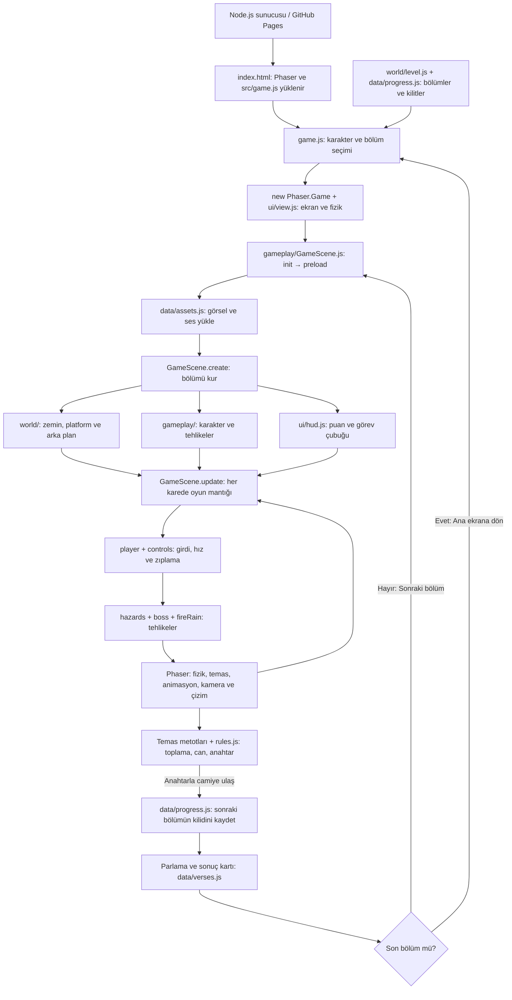

# Meyve Oyunu 2026

8–10 yaş için **JavaScript + Phaser** ile geliştirilen bir platform oyunu.
Amaç hem oyunu geliştirmek hem de kodunu adım adım anlayarak öğrenmek.
Bu bir öğrenme ve deneme projesidir; senaryo zamanla değişebilir. Yeni özelliklerde
çocukların kullanımı, okunabilir JavaScript ve bilgisayar/telefon/tablet desteği birlikte düşünülür.
Mobil desteği korumak için klavye ve dokunmatik giriş aynı hareket koduna bağlanır.

## İnternetten oyna

Adres: https://talhasavash.github.io/PhaserGameProject/

`main` dalına push yapılınca **Publish game** iş akışı testleri çalıştırır ve
`scripts/build-site.cjs` ile hazırlanan `dist` klasörünü GitHub Pages'e ücretsiz yayımlar.
Ek yükleme gerekmez; bilgisayarın veya yerel Node.js sunucusunun açık kalması gerekmez.
İşlem anlık değildir: GitHub'daki Actions ekranında başarılı olunca sayfayı yenile.
Açık oyun kendiliğinden yeniden başlamaz. Sol üstteki `Demo · ...` bilgisi yayındaki commit'i gösterir.
Yayın kopyasında JS, CSS ve görsel adreslerine commit bilgisi eklenir; kaynak kod değişmeden
eski tarayıcı önbelleğiyle yeni dosyaların karışması önlenir. `dist` Git'e eklenmez.

Oyun sayfası ekranı kaplar; dışarıda başlık, açıklama veya site alt bilgisi yoktur.
Destekleyen tarayıcılarda **Tam ekran** düğmesi tarayıcı çubuklarını da gizler.
Telefon/tablette dokunmatik sol, sağ ve zıplama düğmeleri görünür. İki parmakla
aynı anda yürüyüp zıplanabilir. Yatay kullanım daha büyük bir oyun görüntüsü sağlar;
oyun oranı korunur, görüntü esnetilmez. Yatay mobilde oyun bütün ekranı kaplar;
düğmeler karakterin altında kalan toprak alanındadır. Dikey telefonda görüntü oranı korunur.
Yatay telefonda 600 yerine 320 dünya birimi yükseklik gösterilir; üst/alt şeritler de
kaldırıldığı için karakter ve nesneler daha büyük görünür. Tablet görünümü 480 birimdir.
Bu değerler `src/ui/view.js` içindedir. Kamera zemine göre sabittir; zıplarken dikey kaymaz.
Bölüm numarası/can/yıldız/anahtar/puan bilgileri ince bir üst satırdadır.
Üst satır ekran genişliğinin yaklaşık %63'ünü kaplar. Küçük nota düğmesi sesleri açıp kapatır.
Zıplama, toplama, çarpma, can yenileme ve anahtar alma kısa ses efektleri kullanır.
`preload()` içindeki `load.audio` WAV dosyalarını yükler; `sound.play` olay gerçekleştiğinde çalar.
Ses dosyaları `assets/audio` içindedir; özgün tonları `node scripts/build-sounds.cjs` yeniden üretir.
Tarayıcıların ses kuralı nedeniyle ilk tıklama/dokunmadan sonra ses açılır; Phaser bunu yönetir.
Oyun sırasında açılan ipucu/uyarı kutuları ve uyarı tabelaları kapalıdır.
Durum mesajları yalnızca ekran okuyucu için görünmeyen alanda tutulur.
Tam ekranda destekleyen telefonlarda yatay yön istenir. Fiziksel cihaz kontrolü ayrıca yapılmalıdır.
Hem dokunmatik hem klavye zıplamasında erken bırakmak kısa, basılı tutmak yüksek zıplama yapar.
Çok kısa dokunuşlar saklanır; mobilde ilk 70 ms yükseliş korunur, sonra bırakma algılanır.

## JavaScript mi, Phaser mı?

JavaScript programlama dilimizdir. Phaser, JavaScript ile kullandığımız oyun kütüphanesidir.
İkisini birlikte kullanıyoruz.

Kullanılan Phaser sürümü **4.2.1**. Kütüphane `lib/phaser.min.js` içinde yerel olarak tutulur;
oyun açılırken CDN'den indirilmez. Dosya, [resmî sürüm sayfasında](https://phaser.io/download/release/v4.2.1)
belirtilen [sabit sürümlü CDN adresinden](https://cdn.jsdelivr.net/npm/phaser@4.2.1/dist/phaser.min.js) alınmıştır.
Bu dosyayı elle düzenlemiyoruz; kendi oyun kodumuz `src` klasöründedir.
Phaser'ın MIT lisansı `lib/PHASER-LICENSE.md` dosyasındadır.
3.90.0'dan 4.2.1'e geçişte mevcut standart Scene, Arcade Physics, animasyon ve
Graphics API'leri korundu. Özel WebGL pipeline veya DynamicTexture kullanılmadığı
için oyun kodunda uyarlama gerekmedi. Yeni WebGL çizicisi motorla birlikte aktiftir.
Geçiş rehberi: https://github.com/phaserjs/phaser/blob/v4.2.1/changelog/v4/4.0/MIGRATION-GUIDE.md

| İş | Sorumlusu |
| --- | --- |
| Sprite ve görselleri ekrana çizmek | Phaser |
| Yerçekimi ve çarpışma hesapları | Phaser Arcade Physics |
| Klavyeyi okumak, animasyon ve kamera takibi | Phaser |
| Kaç elma toplanacağı, kaç puan kazanılacağı | Bizim JavaScript kodumuz |
| Anahtarın ne zaman çıkacağı, bölümün ne zaman biteceği | Bizim JavaScript kodumuz |
| Yerel sunucudan dosyaları tarayıcıya sunmak | Node.js; oyun motoru değildir |

Örneğin `player.setVelocityX(235)` dediğimizde sağa hareket etme isteğini biz belirleriz;
fizik gövdesini zamana göre hareket ettiren Phaser'dır.

## Proje yapısı

```text
PhaserGameProject/
├── index.html             Sayfa; Phaser'ı ve src/game.js dosyasını yükler
├── css/style.css          Sayfanın görünümü
├── src/
│   ├── game.js                 Giriş noktası, menü, ekran ve fizik ayarları
│   ├── gameplay/               Oyun davranışları
│   │   ├── GameScene.js         Phaser sahnesi; kurulum ve bölüm akışı
│   │   ├── player.js            Karakter, hızlanma, zıplama ve animasyon
│   │   ├── controls.js          Mobil çoklu dokunma
│   │   ├── rules.js             Puan, can ve görev kuralları
│   │   ├── hazards.js           Düşman oluşturma ve hareketleri
│   │   ├── boss.js              Muhafız zıplaması ve öfkesi
│   │   └── fireRain.js          Ateş topları ve gölge uyarısı
│   ├── world/                  Bölümler ve ortam
│   │   ├── level.js             Bölüm tanımları ve nesne konumları
│   │   ├── terrain.js           Zemin, çukurlar, buz ve platform gövdeleri
│   │   ├── platforms.js         Bölüme özel basamak çizimleri
│   │   ├── background.js        Arka plan, cami ve abdest alanı çizimleri
│   │   └── chapterScenery.js    Diğer ortamların arka planları
│   ├── ui/
│   │   ├── hud.js               Bölüm numarası, can, görev ve puan
│   │   └── view.js              Telefon/tablet için dünya boyutu
│   └── data/
│       ├── assets.js            Phaser Loader görsel ve ses listeleri
│       ├── progress.js          Tarayıcıda bölüm ilerlemesini saklama
│       └── verses.js            Sonuç kartlarındaki ayet verileri
├── assets/
│   ├── images/            Oyunun kullandığı SVG görseller
│   └── legacy/            Özgün projeden korunan, şu an yüklenmeyen görsel ve sesler
├── lib/phaser.min.js       Kütüphane; bu dosyayı düzenlemiyoruz
├── scripts/               Yerel sunucu, kontrol ve görsel üretim araçları
├── tests/                 Oyun kurallarını kontrol eden testler
└── .run/                  IntelliJ Run ayarı
```

`src` tarayıcıda çalışan oyun kodudur. `scripts` geliştirme araçlarıdır; `tests` doğrulama kodudur.
Bu nedenle bütün JavaScript dosyalarının aynı klasörde olması gerekmez.
`.idea` ve `.git` IDE'nin ve Git'in yönetim klasörleridir; oyun kaynak kodu değildir.

Önceki `archive/game.js` bağımsız bir canvas denemesiydi; Phaser oyununun giriş dosyası değildi.
`archive/anim.js` de yüklenmeyen bir örnekti. Arşiv klasörü kaldırıldı. İkisi de önceki Git
commit'lerinde korunur. **Şimdiki `src/game.js` yeni ve aktif giriş dosyamızdır.**
Eski görsel ve sesler silinmedi; `assets/legacy` içinde korundu. Oyun bu klasörü yüklemez.

## Kodu hangi sırayla okuyalım?

Çalışma sırası ile öğrenme sırası aynı olmak zorunda değil. İlk okumada aşağıdaki
sırayı izle; çağrılan her yardımcı fonksiyonun içine hemen girmek gerekmez.

| Sıra | Dosya | Önce neye bakmalı? |
| --- | --- | --- |
| 1 | `index.html` | Oyun alanı, menü ve iki script etiketi |
| 2 | `src/game.js` | `startSelectedGame` ve `startGame`; seçimin Phaser'a aktarılması |
| 3 | `src/gameplay/GameScene.js` | Yalnızca `init`, `preload`, `create`, `update`; ana akış |
| 4 | `src/data/assets.js` | Görsel/ses anahtarları ve Phaser Loader |
| 5 | `src/world/level.js`, `terrain.js` | Bölüm verilerinin fizik zeminine dönüşmesi |
| 6 | `src/gameplay/player.js`, `controls.js` | Girdi, hızlanma, zıplama ve animasyon; ardından mobil parmak takibi |
| 7 | `src/gameplay/rules.js` | Puan, yıldız, anahtar ve can; sonra GameScene'deki temas metotlarına dön |
| 8 | `src/ui/hud.js`, `view.js` | Durumun ekranda gösterilmesi ve mobil ekran ölçüsü |
| 9 | `src/gameplay/hazards.js`, `boss.js`, `fireRain.js` | Devriye, boss öfkesi/zıplaması ve ateş zamanlaması |
| 10 | `src/world/background.js`, `chapterScenery.js`, `platforms.js` | Ortam çizimleri ve doku önbelleği |
| 11 | `src/data/progress.js`, `verses.js` | Bölüm kilitleri, localStorage ve sonuç metinleri |

İlk küçük deneme: `world/level.js` içindeki bir meyvenin `x` konumunu değiştir.
Ardından `gameplay/player.js` içindeki `WALK_SPEED` değerini küçük miktarda değiştir.
Son olarak bir yıldızın `collectFruit → recordFruit → updateHud` yolunu takip et.
`lib/phaser.min.js` kütüphanenin sıkıştırılmış dosyasıdır; öğrenmek için onu okumuyoruz.

### Yeni klasörlerle çalışma akışı

Yerelde `scripts/serve.cjs`, internette GitHub Pages dosyaları sunar. Oyun mantığı
tarayıcıda çalışır; her hareket için sunucuya istek gönderilmez.



### Phaser'ın üç temel aşaması

```text
preload()  → Görselleri yükle. Phaser yüklemeyi bitirince devam eder.
create()   → Karakteri, zemini ve temas kurallarını bir kez oluştur.
update()   → Her karede tuşları ve oyun durumunu kontrol et.
```

`GameScene extends Phaser.Scene`, Phaser'ın standart ekran yapısını kullanır.
`this`, çalışan oyun ekranını temsil eder. Kendi karakter veya oyun durumu sınıfımız yok;
`player.js` ve `rules.js` normal fonksiyonlarla çalışır.
`import` başka dosyadan kod alır; `export` o kodu diğer dosyalara açar.

Örnek Phaser komutları:

```js
player.setVelocityX(235);                    // Sağa hız ver.
player.setVelocityY(-590);                   // Yukarı zıplat. Ekranda yukarı yön negatiftir.
this.physics.add.collider(player, platforms); // Platformdan geçmesini engelle.
this.cameras.main.startFollow(player);       // Kamera karakteri izlesin.
```

Kodda basit değişken, nesne, dizi, `if` ve döngülerle ilerliyoruz.
Hareket kodundaki kısa zaman toleransları, kenardan geç basılan veya yere inmeden önce
basılan zıplamaların algılanması içindir. Hız ve süre sabitleri `player.js` başındadır.
`movePlayer` sırasıyla girdiyi okur, yatay hızı, zıplamayı, animasyonu ve gövde eğimini günceller.
Görsel üretim aracı `scripts/build-art.cjs`, yalnızca SVG dosyalarını yeniden üretir;
oyun kodunu öğrenmek için bu araçtan başlamak gerekmez.

Yayın betiği `src` altındaki klasörleri de dolaşır; `./` ve `../` importlarına aynı
commit sürümünü ekler. Eski klasör düzeninden kalan dosyalar yalnızca üretilen
`dist/src` içinde temizlenir. `tests/build-site.test.js` yayın kopyasının importlarını,
sürüm bilgisini ve kaynak dosyaların değişmediğini kontrol eder.

## Kodun görevleri ve Phaser kullanımı

Dosyalar gameplay, world, ui ve data klasörlerinde görevlerine göre gruplanır. Yeni sınıf,
bağımlılık veya karmaşık bir katman sistemi eklenmedi. Bölüm tanımları `level.js`
içinde veri olarak kalır; yeni bölüm eklemek için ana oyun döngüsü değiştirilmez.

- `GameScene.preload` → `assets.js`: görselleri ve sesleri Phaser Loader'a verir.
- `GameScene.create` → dünyayı kurar, karakteri oluşturur ve Phaser collider/overlap bağlantılarını yapar.
- `GameScene.update` → karakter, kamera, düşmanlar, bant, kontrol noktası ve ilerlemeyi günceller.
- `hazards.js` → devriye, zıplama, öfke ve ses görevleri ayrı kısa fonksiyonlardır.
- `hud.js` → Phaser Container, Text ve Graphics kullanır. `terrain.js` sabit fizik gruplarını kurar.

Phaser'ın Arcade Physics, animasyon, kamera, tween, ses ve zamanlayıcı sistemlerini
kullanıyoruz. Hız sınırını `Phaser.Math.Clamp`, yumuşak geçişleri `Phaser.Math.Linear`,
bant oklarının dolaşımını `Phaser.Math.Wrap` sağlar. Phaser'ın SHUTDOWN ve DESTROY
olayları hem bölüm değişiminde hem menüye dönüşte giriş/ekran dinleyicilerini temizler.

Zıplama toleransı, kısa/uzun zıplama, buzda fren ve son basılan yönün önceliği
oyuna özel küçük JavaScript fonksiyonlarıdır. Bunları fizik motoruna bırakmak aynı
hareket hissini sağlamaz. `rules.js` puan/görev kurallarını, `progress.js` tarayıcı
kaydını yönetir; bu işler için Phaser'a bağımlılık gerekmez. HTML menüler ve mobil
butonlar tarayıcı olaylarını kullanır; çoklu dokunma testleri korunur.

## IntelliJ ile çalıştırma

1. Bu README'nin bulunduğu ana klasörü aç.
2. Üst çubuktan **Meyve Oyunu** Run ayarını seçip Run düğmesine bas.
3. Gerekirse **Run → Edit Configurations → Node runtime** alanından Node.js'i seç.
4. http://localhost:8095 adresini aç. Stop düğmesi sunucuyu kapatır.

Oyun açılınca erkek çocuk veya başörtülü kız çocuk seç, ardından **Maceraya başla** düğmesine bas.
Phaser seçimin ardından başlatılır. İki karakterin hızları, çarpışma kutuları ve özellikleri aynıdır.
R ve Yeniden başla düğmesi seçili karakteri korur; başka karakter seçmek için sayfayı yenileyebilirsin.

Terminalden de çalışır:

```sh
node scripts/serve.cjs
```

Node.js 18 veya üzeri gerekir. Ek bağımlılık kurulumu gerekmez. Npm varsa `npm start` kullanılabilir.
HTML, CSS ve oyun kodu değişince dosyayı kaydet, tarayıcıyı yenile. Sunucuyu yeniden başlatmak gerekmez.
Sunucu kodu değişirse sunucuyu yeniden başlat. Aynı portta ikinci bir sunucu çalıştırma.
HTTP kullan; HTML dosyasını çift tıklayarak açma (oyun ES modülleri kullanır).

## Oynanış

- Oklar veya A/D: yürü. Yukarı ok, W veya Boşluk: zıpla.
- Esc: mola/devam. R: bölümü baştan başlat.
- Üç altın yıldızı tamamla, ileride çıkan anahtarı al ve açılan cami kapısına ulaş. Elmalar 30 puan verir; anahtarı açmaz.
- Görev yıldızı 40; elma, armut, portakal, muz, üzüm ve çilek 30 puan verir. Yaban mersini ve tesbih taneleri 10, seccadeler 20 bonus puandır. Kirpiye, salyangoza ve taşa dokunma.
- Bayrak kontrol noktasını etkinleştirir ve canları doldurur.
- Can bitince geri dönülür; toplananlar korunur. R veya sayfa yenileme bütün bölümü sıfırlar.
- İki yön tuşu birlikte basılıysa son basılan yön önceliklidir; havada da yön değiştirilebilir.
- Tuş bırakılınca karakter süzülerek yavaşlar. Hızlanma, fren ve dönüş değerleri `player.js` başındadır.
- Abdest alanları eksikse bir can doldurur; her biri bölümde bir kez kullanılabilir. Canlar doluysa hak harcanmaz.
- Can kazanıldığında 2,2 saniye gülümseme ve karakteri takip eden yıldız parıltıları görünür.
- Çarpınca yüz 1,5 saniye üzgün olur. İfadeler yürüme ve zıplama sırasında da devam eder.
- Boyut ayarları: `player.js` içindeki `PLAYER_SCALE` ve `GameScene.js` içindeki `COLLECTIBLE_SCALE` ve `hazards.js` içindeki `ENEMY_SCALE`.
- Dururken sallanma yoktur. Zıplama pozundaki kaldırılmış kol iki karakterde de başın yanında açıkça görünür.
- Bant sola taşır; bu bir buz sürtünmesi değildir.

## On bir bölümlü akış

Başlangıçta yalnızca 1 açıktır; her bölüm bitince sonraki açılır. Ana ekranda yalnızca
numaralar görünür. 11. bölüm altın renkli özel bir çemberdir. Menü `levels` dizisinden
üretilir. `progress.js` açılan bölüm sayısını `localStorage` içinde saklar. Önceden
4 bölüm açmış bir tarayıcı yeni sürümde de 4'ten devam eder; kayıt silinmez.
Tarayıcı verileri silinirse ilerleme sıfırlanır; farklı cihazlara eşitlenmez.

| Bölüm | Ortam ve yeni mekanik |
| --- | --- |
| 1 | Meyve bahçesi; hareket, yıldızlar, anahtar ve cami kapısı |
| 2 | Kandilli avlu; yüksek basamaklar, hızlı hayvanlar ve taşlar |
| 3 | Çöl; palmiye siluetleri ve seyrek rastgele ateş |
| 4 | Gece bahçesi; daha dar basamaklar, hareketli engeller |
| 5 | Orman; arılar, tilkiler ve ilk gerçek çukurlar |
| 6 | Cami içi; halılar, kolonlar, lafzatullah tabloları, örümcekler ve tekerlekler |
| 7 | Karlı dağ; penguenler, kuşlar, buz ve yarıklar |
| 8 | Dere geçitleri; kurbağalar, kaplumbağalar ve su boşlukları |
| 9 | Kaya vadisi; yarasalar, alçak geçitler, buz ve seyrek ateş |
| 10 | Bayram bahçesi; önceki engellerin birleşimi ve daralan geçişler |
| 11 | Boss; büyük zıplayan muhafızların altından geçerek son camiye ulaşma |

Her bölümde 3 görev yıldızı bulunur. Diğer nesneler sadece puan verir. Anahtar
alınınca caminin iki kapı kanadı yana açılır ve giriş aydınlanır. Camiye ulaşınca çocuk
önce 1,2 saniye yıldızlarla parlar, sonra tamamlanma mesajı ve kısa ayet aynı sonuç
kartında görünür. Ayrı bir okuma ekranı veya görünür kaynak bağlantısı yoktur.
Kart kendiliğinden kapanmaz; Sonraki bölüm veya Enter ile ilerlenir. 11'in sonunda
Ana ekrana dön görünür; düğme veya Enter bölüm seçimine döndürür, 1. bölümü
kendiliğinden başlatmaz. Açılan bölümler korunur. Kaynak ve sure/ayet numaraları denetlenebilmesi için
`src/data/verses.js` içinde saklanır; Diyanet meallerinden kısa alıntılar kullanılır.
Üç nokta ayetin yalnızca bir kısmının alındığını gösterir.

`GameScene` bütün bölümlerde aynıdır. Phaser `init(data)` ile bölüm numarası ve
önceki bölümlerden taşınan puanı alır; `scene.restart({ levelIndex, score })` yeni
bölümü kurar. Karakter ve ses tercihi korunur. Yeni bölümde yıldızlar, anahtar ve
canlar sıfırlanır. R/Yeniden başla mevcut bölümü tekrar başlatır.

Basamaklar her bölümde farklı malzeme ve biçimde çizilir: çimen, taş, kumtaşı,
bulut, kütük, halı, buz, köprü, kaya, bayram süsü ve metal. Bazı ileri bölümlerde
50–90 birim genişlikte tek basamak zincirleri vardır. `platforms.js` çizimleri
boyut ve temaya göre bir kez dokuya çevirip önbelleğe alır. Fizik yüzeyleri düz
kalır; süsler çarpışma davranışını değiştirmez. Son bölümün camisinde de taş
kemerli cam pencereler ve mavi gri metal kapılar kullanılır.

Çukurlar sadece bir renk değişikliği değildir: o aralıklarda fizik zemini kurulmaz.
Karakter gerçekten aşağı düşer; düşerken üzülür ve deneme biter. Yeniden dene,
**mevcut bölümün başından** başlatır; o bölümde toplananlar da sıfırlanır.
Önceki bölümlerin toplam puanı ve açılmış bölüm kilitleri korunur. Normal hayvan
çarpmalarında mevcut can/kontrol noktası kuralları devam eder.

Buz açık mavi parlak şeritlerle çizilir. `movePlayer` fonksiyonunun son `grip`
parametresi buzda 0.14 olur: fren ve yön değiştirme yavaşlar; zıplama kuvveti aynı
kalır. `bossLift` muhafızın yüksekliğini zamanla hesaplar. Görsel ve fizik gövdesi
birlikte taşınır; havalanınca altından geçmek mümkündür. Muhafızlara saldırmak
veya onları yenmek gerekmez; zamanlamayla geçmek yeterlidir.

Muhafızların dördü farklı SVG görünümü kullanır. Son turuncu muhafız, oyuncu
450 dünya birimi yakınına geldiğinde öfkelenmeye başlar. Mesafe azaldıkça öfke
artar; temas veya çarpma gerekmez. Yakınında beklemek de öfkeyi artırır; en geç
18 saniyede yüzü değişir, rengi kızarır ve zıplama saati en çok 1.6 kat hızlanır.
Uzaklaştıkça sakinleşir; 450 birimde normal rengine ve hızına döner, bekleme süresi sıfırlanır. Saat kareler boyunca
biriktirilir; hız değişirken zıplamanın ortasında konum atlaması olmaz. Öfke ve
zıplama duraklatmada ilerlemez; bölüm yeniden başlayınca sıfırlanır.
Tam öfkede bile muhafızın altından geçiş süresi test edilir. Can bitip kontrol
noktasına dönüldüğünde de öfke, renk ve hız sıfırlanır. Muhafızların kalkış ve
iniş sesleri yalnızca geçiş anında çalar; uzak muhafızlar duyulmaz. Ses kapatma
düğmesi bunları da kapatır. `build-sounds.cjs --boss-only` bu iki WAV'ı üretir.

6. bölümün son yapısında ahşap pencere bölmeleri yerine taş kemerli açık renkli
vitraylar vardır. Lafzatullah görseli `allah-plaque.svg` içinde standart Arapça
Allah ligatürüyle (U+FDF2) oluşturulur ve arka planda aynı doku tekrar kullanılır.

Ateş olan bölümlerde aynı anda en çok bir top bulunur. Her top bittikten sonra
en az 8 saniye beklenir; konum, hız ve süre değişir. Önceden yalnızca parlak,
beyazımsı elips gölge gösterilir. Ünlem, üçgen ve dikey ışık yoktur. Hedef uyarı
başladıktan sonra yer değiştirmez. Başlangıç, abdest alanları, kontrol noktaları ve
çukurlar hedef seçiminde korunur.

Sağ üstteki ☰ ayar panelini açınca oyun duraklar. Ses, tam ekran, yeniden başlatma
ve bölüm seçimi buradadır. Devam et ile oyun sürer. Yönler saydam üçgen,
zıplama saydam dairedir. Yönler sol alt kenara bitişik ve aralıksız, zıplama sağ
alt kenara sabittir; telefonun güvenli ekran boşlukları korunur. İki parmakla yön
ve zıplama bağımsız kullanılabilir.
Zıplama basış süresine bağlıdır; erken bırakma kısa, basılı tutma yüksek zıplamadır.

Arka planlar küçük dokulara bir kez çizilir ve `TileSprite` ile tekrarlanır. İlk
bahçenin arka plan nesne sayısı 213'ten 18'e indirilmiştir; bu bir FPS ölçümü
değildir. Gerçek telefon performansı ayrıca kontrol edilmelidir. Her bölümün
camisi ayrı cephe/kubbe/minare düzeni kullanır. Yeni hayvan ve yıldız SVG'leri
`node scripts/build-chapter-art.cjs` ile üretilir; mevcut karakter ve seccade
SVG'lerine dokunulmaz.

## Kontroller ve Git

```sh
node scripts/check.cjs
node --test tests/*.test.js
```

Npm varsa `npm run check` ve `npm test` eşdeğerdir.
Uzak depo: https://github.com/talhasavash/PhaserGameProject
Özgün oyun ilk commit'te saklıdır. Eski dosyalara ihtiyaç duyarsak Git geçmişinden alabiliriz.
